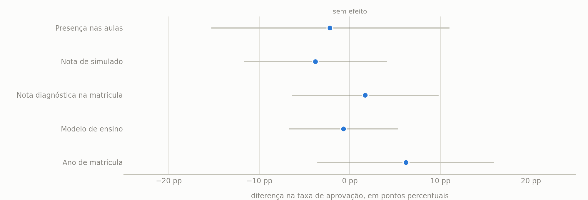
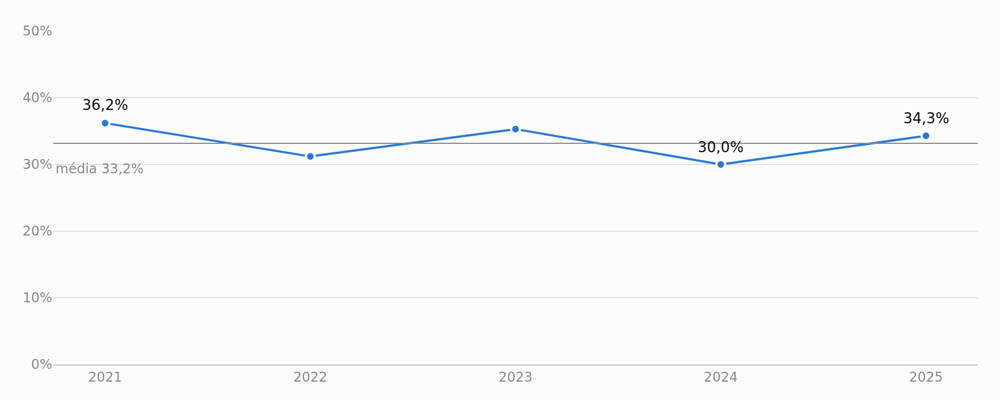
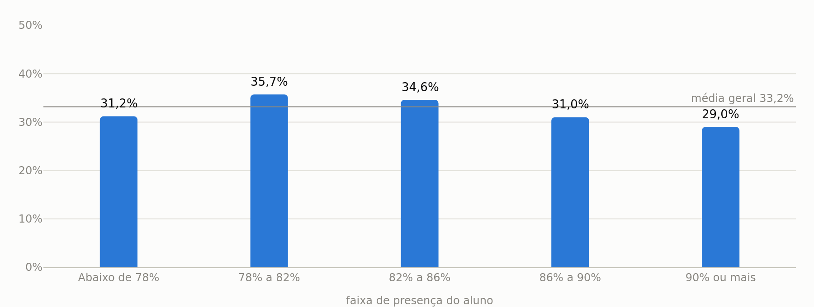
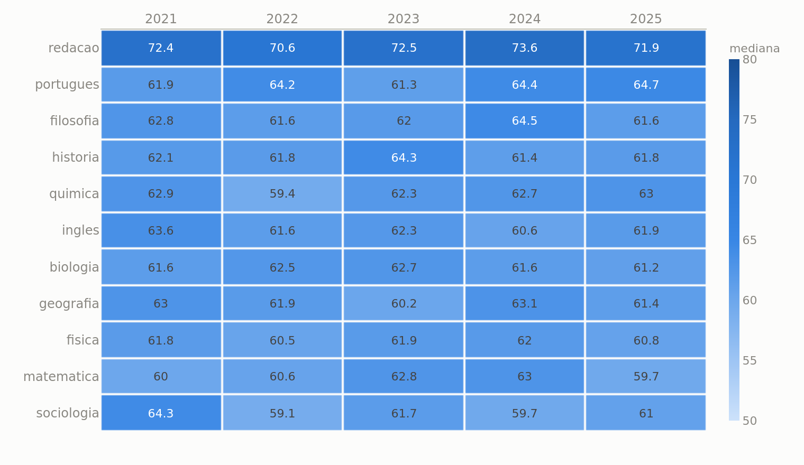
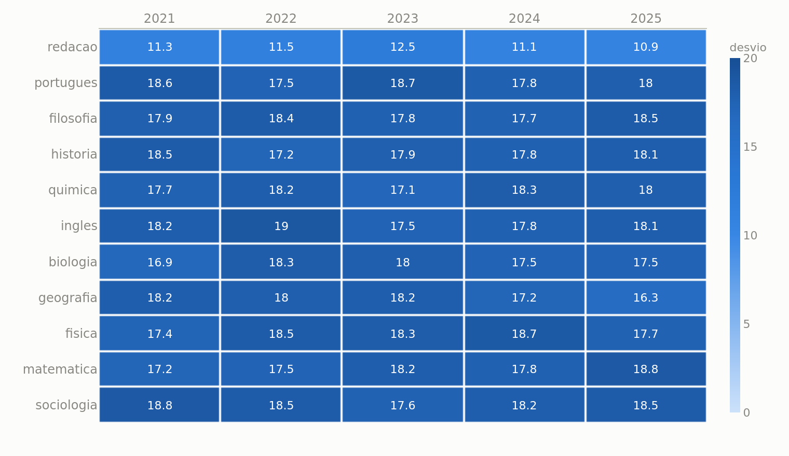
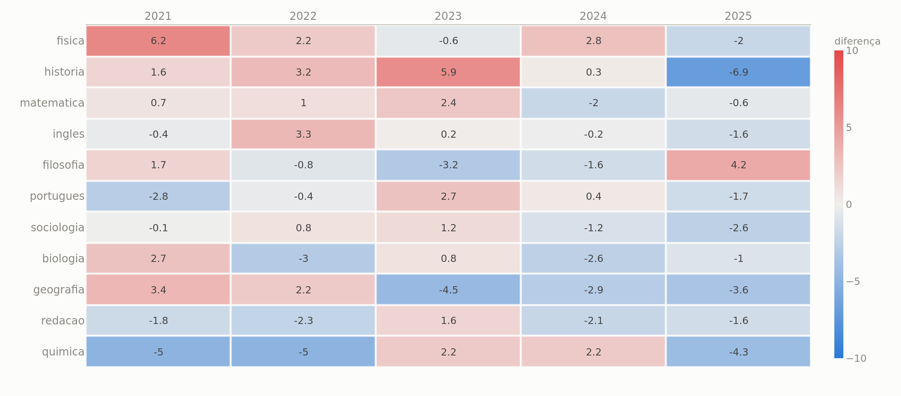
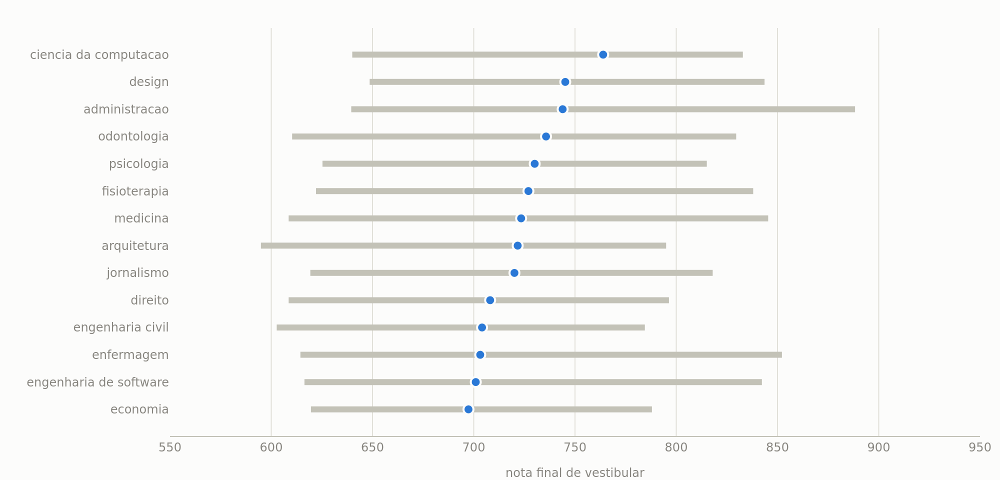
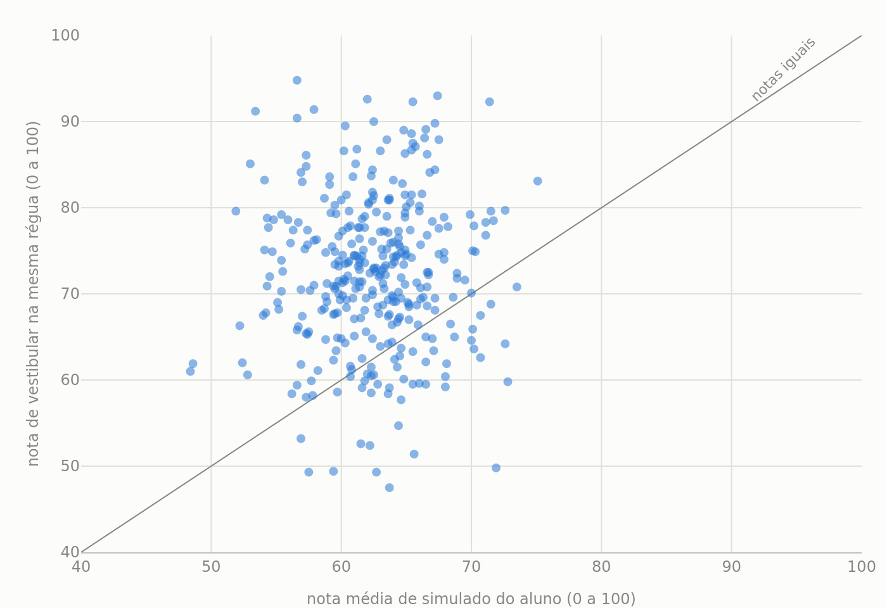
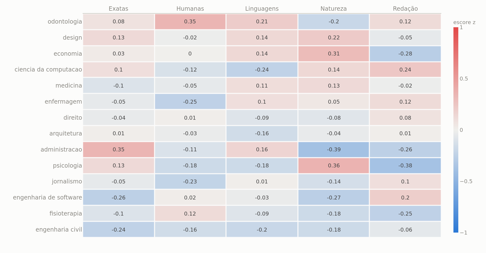
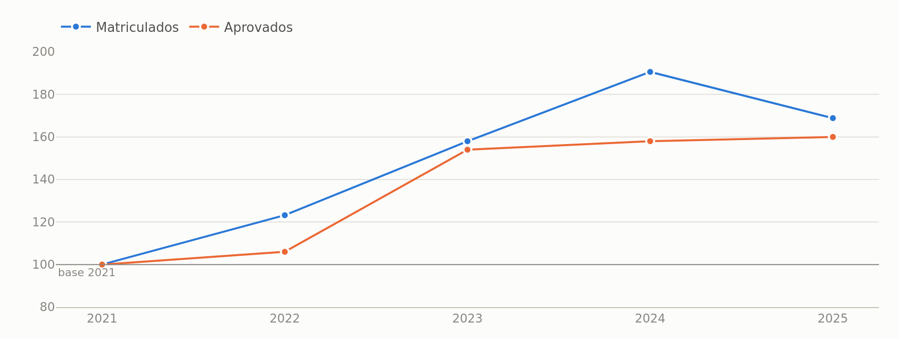

# Relatório final: AprovaEdu Analytics

Este relatório responde às perguntas do desafio e reúne os achados e as
recomendações. Todos os números saem das consultas em `src/dashboard/querys/`, que
rodam como SQL puro e podem ser conferidas fora do dashboard. Os gráficos são os
mesmos do dashboard, gerados por `scripts/gerar_imagens_relatorio.py`.

A base cobre 2021 a 2025, com 1.022 pares de aluno e ano matriculados, 339
aprovações no vestibular, 18.299 simulados concluídos e 74.997 registros de presença.

## A conclusão

Vale começar pelo achado central, porque ele muda o tipo de recomendação que o
relatório pode fazer: **nenhum dos fatores testados distingue quem passa de quem não
passa no vestibular.**

| Fator | Diferença na taxa de aprovação | Intervalo de 95% |
|---|---:|---|
| Presença nas aulas | −2,2 pp | −15,3 a +11,0 |
| Nota de simulado | −3,8 pp | −11,7 a +4,1 |
| Nota diagnóstica na matrícula | +1,7 pp | −6,4 a +9,8 |
| Modelo de ensino | −0,7 pp | −6,7 a +5,3 |
| Ano de matrícula | +6,2 pp | −3,6 a +15,9 |

Cada linha compara o grupo alto com o grupo baixo do fator, na mesma unidade: pontos
percentuais de taxa de aprovação. **Os cinco intervalos contêm o zero**, o que
significa que nenhuma dessas diferenças se distingue de nenhuma diferença.

E o maior efeito da tabela é a variação entre dois anos. A oscilação natural de um ano
para o outro é maior do que qualquer fator que a coordenação controla.

Isso não é ausência de resposta. Muda a resposta: em vez de apontar onde investir para
melhorar a conversão, o relatório aponta onde a coordenação está livre para decidir por
custo, e o que falta registrar para conseguir responder melhor.

---

## 1. Evolução da taxa de aprovação

### Como a taxa foi definida

A taxa é medida sobre os **alunos matriculados em cada ano**, e não pela contagem das
linhas da tabela de aprovações. A pergunta que ela responde é concreta: dos alunos que
fizeram o cursinho num ano, quantos passaram no vestibular daquele mesmo ano.

Contar as aprovações soltas somaria passagens sem saber se o aluno estava matriculado
no período, e misturaria anos diferentes. Medindo sobre os matriculados, a taxa
significa "efetividade do preparo daquele ano".

O denominador vem de `matriculas` e o numerador é conferido contra `aprovacoes`, então
"não aprovado" é ausência real de aprovação, e não dado que faltou.

### Resultado

| Ano | Matriculados | Aprovados | Taxa | Variação vs. ano anterior |
|---|---:|---:|---:|---:|
| 2021 | 138 | 50 | 36,2% | — |
| 2022 | 170 | 53 | 31,2% | −5,0 pp |
| 2023 | 218 | 77 | 35,3% | +4,1 pp |
| 2024 | 263 | 79 | 30,0% | −5,3 pp |
| 2025 | 233 | 80 | 34,3% | +4,3 pp |

**A taxa não tem tendência.** O maior valor é 36,2% em 2021 e o menor é 30,0% em 2024,
uma diferença de 6,2 pontos percentuais em torno da média de 33,2%. De um ano para o
outro a taxa alterna entre subir e cair, com três trocas de sinal em quatro intervalos,
sem seguir direção nenhuma. Esse vai e vem é o que se espera de variação normal entre
turmas, e não de um preparo que melhorou ou piorou.

**O que de fato cresceu foi a operação.** Os matriculados por ano subiram de 138 para
233, um aumento de 68,8%. Os aprovados subiram de 50 para 80, ou 60,0%. Como os dois
crescem quase no mesmo ritmo, a taxa fica parada. Em outras palavras, o cursinho vem
formando mais aprovados em número absoluto, mas converte sempre a mesma proporção de
alunos.

Vale notar que o melhor ano é o primeiro, com a menor turma, e o pior é 2024, com a
maior. Um ano não prova relação entre crescer e converter menos, mas é a hipótese que
vale acompanhar.

---

## 2. Presença nas aulas e aprovação

### O que conta como presença

Presença é o comparecimento do aluno às aulas registradas do ano: contam as aulas em
que ele esteve presente ou chegou atrasado, porque o aluno atrasado esteve na aula.
Falta justificada não conta como comparecimento, já que continua sendo falta, só com
explicação.

### Resultado

**Não há relação detectável.** A presença média de quem passou é 83,8% e de quem não
passou é 84,0%, uma diferença de −0,2 ponto percentual. Com 1.022 casos, a margem de
erro dessa diferença vai de −0,8 a +0,4 ponto, ou seja, ela inclui o zero. A correlação
entre presença e aprovação é de −0,023, praticamente zero. E em 4 dos 5 anos quem não
passou teve presença **maior** que quem passou.

**Frequentar mais não aumenta a chance de passar.** Separando os alunos por faixa de
presença:

| Faixa de presença | Alunos | Taxa de aprovação |
|---|---:|---:|
| Abaixo de 78% | 93 | 31,2% |
| 78% a 82% | 235 | 35,7% |
| 82% a 86% | 356 | 34,6% |
| 86% a 90% | 245 | 31,0% |
| 90% ou mais | 93 | **29,0%** |

A taxa não sobe da esquerda para a direita. A faixa de maior presença tem a **menor**
taxa de aprovação de todas.

### Por que isso não significa que faltar não custa

A presença varia pouco nesta base: vai de 70,3% a 97,1%, e metade dos alunos fica entre
81,2% e 86,9%. Não existe aqui o aluno de presença baixa que serviria de contraprova.
O que foi medido é o efeito de frequentar 81% contra 87% das aulas, e não o de faltar
muito.

Uma ressalva de método: a presença é calculada sobre as **aulas registradas**. As aulas
registradas somam 2.645 horas contra 9.302 contratadas nas ofertas, 28,4% do total.
Então a métrica mede comparecimento às aulas que existem no sistema, e não frequência
do aluno no curso contratado. As duas coisas não são a mesma, e a base não permite
calcular a segunda.

---

## 3. Desempenho por matéria e por curso

A pergunta tem duas leituras, e elas medem coisas diferentes. Matérias são o que o
cursinho ensina, e o desempenho nelas vem dos simulados. Cursos são onde o aluno passou
no vestibular, e a nota do curso diz mais sobre a concorrência dele do que sobre o
preparo.

### 3.1 Nenhuma matéria se destaca, em nenhum ano

Entre as 10 matérias objetivas, a mediana da nota de simulado fica entre **61,2 e
63,3** numa escala de 0 a 100. Nenhuma matéria varia mais de 3,5 pontos entre o melhor
e o pior ano, e nenhuma fica acima das outras de forma consistente. O desvio padrão é
de ~18,0 pontos em todas elas, ou seja, os alunos se espalham igual em cada matéria.

Não existe aqui a matéria em que os alunos vão mal e que justificaria reforço.

**Redação é o único caso diferente, e não por serem melhores nela.** A mediana dela é
72,2 contra ~62 das objetivas, mas o que explica isso é o espalhamento, não o
desempenho:

| | Objetivas | Redação |
|---|---:|---:|
| Mediana | ~62 | 72,2 |
| Desvio padrão | 18,0 | **11,5** |
| Percentil 10 | ~38 | **58** |

O desvio de redação é quase a metade, e os 10% piores em redação ficam acima de 58,
contra 38 nas objetivas. É o comportamento esperado de correção de texto: é avaliação
subjetiva, e banca de redação raramente dá nota muito baixa. Quase ninguém vai mal, e é
isso que empurra a mediana para cima.

Nota técnica: redação é corrigida de 0 a 1000 e as demais matérias de 0 a 100, então
todas as comparações usam a coluna `nota_norm`, que é a nota capada nos limites da
própria matéria e reescalada para 0 a 100.

### 3.2 Nota em matéria nenhuma separa quem passa de quem não passa

Comparando a mediana dos aprovados com a dos não aprovados em cada matéria e ano, os
aprovados vão melhor em 25 das 55 combinações, quando o simples acaso daria cerca de
27. A diferença média é de −0,2 ponto. E **nenhuma matéria tem os aprovados à frente
nos cinco anos**, que é o que se esperaria de uma matéria que de fato pesasse na
aprovação.

### 3.3 Nos cursos, o ranking de nota não se sustenta

A mediana da nota de vestibular vai de 697,4 (economia) a 763,9 (ciência da
computação), uma diferença de 66,5 pontos. Só que a faixa que cobre 80% dos aprovados
de cada curso tem em média **207 pontos de largura**, várias vezes maior que a
distância entre o primeiro e o último. As faixas se sobrepõem quase inteiramente, e é
por isso que trocar posições dessa lista não significa nada.

Além disso, a nota do curso não mede o cursinho: ela reflete a concorrência do curso,
isto é, quanto foi preciso tirar para entrar. Curso com mediana alta é curso disputado,
não curso em que o cursinho prepara melhor.

O indicador de curso que se sustenta é contagem, não média: **enfermagem** é onde o
cursinho colocou mais alunos no período, com 28 dos 339 aprovados.

### 3.4 O simulado é mais severo que o vestibular

Comparando, para cada aluno aprovado, a média dos simulados dele com a nota de
vestibular do mesmo ano, as duas na régua de 0 a 100:

- a diferença mediana é de **+10,1 pontos** a favor do vestibular;
- **85,3%** dos 339 alunos tiraram no vestibular mais do que a própria média de
  simulado;
- o padrão se repete nos cinco anos, com mediana entre +6,3 e +11,0 pontos.

Duas leituras, e é importante separar as duas. A primeira é de calibragem: o simulado
do cursinho é mais severo do que a prova que ele prepara. A segunda é de seleção: nota
de vestibular só existe na base para quem passou, e passar exige nota alta, então esse
grupo já é o dos que foram bem na prova. Parte dos 10 pontos é isso. Com esta base não
dá para separar as duas coisas.

O que dá para afirmar com segurança é que **o simulado não está superestimando o
aluno**, o que seria o risco real, e que **a nota de simulado não prevê a nota de
vestibular**: a correlação entre as duas é de 0,035, e a nuvem de pontos não tem
inclinação nenhuma.

### 3.5 A matéria forte do aluno não indica o curso em que ele passa

Se houvesse relação, os aprovados de medicina viriam acima da média em Ciências da
Natureza, os de engenharia em Matemática, os de direito em Humanas. Padronizando a nota
dentro de cada área e ano, e cruzando as 5 áreas do ENEM com os 14 cursos, **nenhuma
das 70 combinações passa de dois erros padrão**, quando o próprio acaso produziria
cerca de 4. O valor mais extremo da tabela é 0,39 desvio, e nem ele escapa da margem.

O agrupamento por área foi necessário por tamanho de amostra: são 339 aprovados no
período, e cruzar 11 matérias com 14 cursos daria células de 2 alunos.

---

## 4. Análises complementares

### 4.1 Modelo de ensino não muda resultado nem frequência

**Frequência**, medida pela modalidade de cada aula, fica entre 83,8% e 84,1% nas
quatro modalidades. Aula online não tem mais falta que aula presencial, e o padrão se
repete em todos os anos.

**Aprovação** só permite comparar dois grupos, não três. A modalidade é atributo da
oferta, e olhando as combinações que existem de fato, um aluno ou fez tudo online, ou
fez presencial e híbrido ao mesmo tempo. Nenhum aluno fez só presencial, e nenhum fez
só híbrido, porque as ofertas online estão todas na unidade Online e as unidades
físicas oferecem presencial e híbrido lado a lado. Entre os dois grupos: 32,7% de
aprovação para quem estudou só online (367 alunos) contra 33,4% para quem estudou em
unidade física (655 alunos).

### 4.2 Dispositivo e local de aplicação do simulado não mudam a nota

A nota mediana varia **0,9 ponto** entre os cinco dispositivos (celular, desktop,
tablet, papel e sem registro) e **0,4 ponto** entre as cinco unidades de aplicação.
O espalhamento também é igual em todos.

Tentativas também não distinguem: a média fica entre 1,59 e 1,64 por resultado. E
tentativa não compra nota — quem concluiu na primeira tem mediana de 63,3 e quem
precisou de três tem 62,8. Repetir o simulado não melhora o desempenho, então
tentativas mede atrito, não esforço que rende.

### 4.3 Nenhum professor dá aula fora da sua matéria

Das 2.418 aulas da base, **zero** foram em matéria diferente da matéria principal do
professor. Todos os 34 professores lecionam exatamente uma matéria.

Mas o cadastro diz outra coisa: **24 dos 34 declaram ensinar mais matérias do que
lecionam**. A coluna `materias_ensina` lista duas ou três, e a escala usa uma. São duas
leituras possíveis e as duas pedem ação, e estão na recomendação 4 abaixo.

Dentro da própria matéria, os professores não se diferenciam: nem a nota dos simulados
que criam nem o comparecimento às aulas que dão separam professor de professor, e os
intervalos de confiança se sobrepõem quase todos.

---

## 5. Recomendações para a coordenação

### 1. Parar de ler a nota do simulado como previsão de vestibular

Entre os aprovados, a nota de vestibular ficou 10,1 pontos acima da média de simulado
do próprio aluno, e a correlação entre as duas é 0,035, ou seja, zero. Saber que um
aluno tira 55 no simulado não diz nada sobre a nota que ele fará na prova.

O simulado serve como diagnóstico de conteúdo, e é assim que deve ser apresentado ao
aluno e à família. Se a coordenação quiser um termômetro de aprovação, ele precisa ser
construído e validado, porque hoje não existe.

### 2. Decidir modalidade por custo e alcance, não por eficácia

A diferença de aprovação entre quem estuda só online e quem estuda em unidade física é
de 0,7 ponto, com intervalo de −6,7 a +5,3. A frequência também é igual, com 0,2 ponto
de diferença entre modalidades de aula.

Como o formato não muda o resultado, a escolha fica liberada para o critério que de
fato varia: custo por aluno, alcance geográfico e capacidade de sala. O mesmo raciocínio
vale para dispositivo e local de aplicação do simulado, onde a nota varia menos de um
ponto: não há retorno em padronizar equipamento.

### 3. Para mais aprovados, crescer matrícula é o caminho comprovado

De 2021 a 2025 a matrícula cresceu 68,8% e os aprovados 60,0%, com a taxa parada em
torno de 33%. Crescer funcionou e não diluiu a qualidade.

O que a base não oferece é qualquer alavanca de conversão: nenhum fator testado a move.
Então uma meta de número de aprovados deve ser planejada por volume de matrícula, e uma
meta de taxa de aprovação precisa antes de um diagnóstico que esta base não permite
fazer.

### 4. Resolver a habilitação dos professores

24 dos 34 professores declaram ensinar mais matérias do que lecionam. Se a segunda
habilitação é real, existe flexibilidade de escala que não está sendo usada, o que
importa em férias, licença e abertura de turma. Se não é real, o cadastro está errado e
vai embasar uma decisão ruim algum dia. Vale confirmar qual dos dois.

---

## 6. O que passar a registrar

Boa parte do que a coordenação gostaria de saber não está respondida aqui por falta de
registro, e não por falta de análise. Em ordem de impacto:

**1. A nota de vestibular de quem não passou.** Hoje a base só tem nota de aprovado,
então a comparação entre simulado e vestibular usa 339 alunos que, por definição, foram
bem na prova. Sem a nota de quem prestou e não passou, não há como medir a eficácia do
preparo, nem calibrar o simulado, nem saber a que distância do corte os alunos ficaram.
É o registro que mais destravaria análise.

**2. Todas as aulas dadas.** As aulas registradas cobrem 28,4% da carga horária
contratada nas ofertas, com 8 a 14 aulas por oferta contra 30 a 60 horas contratadas.
Nenhuma das 220 ofertas fecha. Enquanto isso não mudar, métrica de carga horária
cumprida é inviável, e a frequência mede comparecimento às aulas registradas.

**3. Presença de quem falta muito.** A presença vai de 70,3% a 97,1%, e metade dos
alunos fica entre 81% e 87%. Não existe aluno de presença baixa. Ou o cursinho não tem
problema de evasão de aula, o que seria notável, ou esses alunos não estão sendo
registrados. Vale confirmar qual dos dois, porque a conclusão de que presença não afeta
aprovação vale para a faixa observada, e não para quem falta de verdade.

**4. Campos que chegam pela metade.** Tentativas do simulado não é informada em 16,9%
dos resultados; 253 aulas (10,5%) têm data anterior ao início da própria oferta, todas
elas antes e no máximo 49 dias antes, o que sugere aula acontecendo antes da abertura
oficial da oferta; e as datas chegam em quatro formatos diferentes, um deles com mês
antes do dia. Nada disso invalida as análises atuais, mas cada um cobra um tratamento
que poderia não existir se a entrada fosse padronizada.

---

## 7. O que não decidir com estes números

O dashboard mostra rankings, e ranking convida a decidir por ele. Quatro coisas que os
números **não** autorizam:

**Não ranquear matéria, curso ou professor.** As medianas existem e podem ser
ordenadas, mas as margens de erro se sobrepõem nos três casos. Entre as matérias
objetivas, a diferença entre primeira e última é de pouco mais de dois pontos numa
escala de 0 a 100. Entre cursos, a faixa que cobre 80% dos aprovados de cada um tem 207
pontos de largura contra 66 de distância entre o primeiro e o último.

**Não criar reforço para "matéria fraca".** Ela não existe nesta base. Os três
indicadores por matéria — nota, conclusão de simulado e presença — ficam na mesma faixa
estreita, e a nota em matéria nenhuma separa aprovado de não aprovado em nenhum ano.

**Não montar turma por perfil de área.** O cruzamento entre a área em que o aluno é
forte e o curso em que ele passou não mostra relação: de 70 combinações, nenhuma escapa
da margem de erro.

**Não tratar redação como a matéria em que os alunos vão melhor.** A nota é mais alta
porque é correção de texto, e o desvio pela metade prova isso.

---

## 8. Notas de método

**Alinhamento por ano em todo cruzamento.** Sempre que uma análise cruza dois fatos com
data (matrícula e aprovação, simulado e vestibular, presença e aprovação), o casamento é
pelo mesmo ano. Isso evita comparar um evento de um ano com outro de outro ano. A regra
não custa nada aqui: todas as 339 aprovações da base têm matrícula no mesmo ano.

**Mediana e desvio ao lado da média.** A média sozinha esconde a forma da distribuição.
A mediana descreve o aluno típico sem ser deslocada por valores extremos, e o desvio é
o que mostra desempenho fora da curva. Foi o desvio, e não a média, que revelou por que
redação parece melhor que as outras matérias.

**Intervalo de confiança em toda comparação.** Ranking sem margem de erro convida a
decidir por diferença que não existe. Onde há ordenação, há intervalo desenhado ao lado.

**Escala de gráfico ancorada em faixa que significa algo**, nunca no intervalo
observado. Esticar uma rampa de cor ou um eixo sobre meio ponto de variação pinta ruído
como se fosse contraste.

**O que não foi corrigido, e por quê.** Duas ambiguidades de data ficaram como estão:
360 registros de `inicio_simulado` e um subconjunto de `data_aula` podem ter dia e mês
trocados, mas não existe referência na base para decidir caso a caso, e reinterpretar
por inferência estatística corromperia mais linhas do que corrigiria. Nenhuma das duas
afeta qualquer número deste relatório, porque os recortes temporais usam a coluna `ano`.
